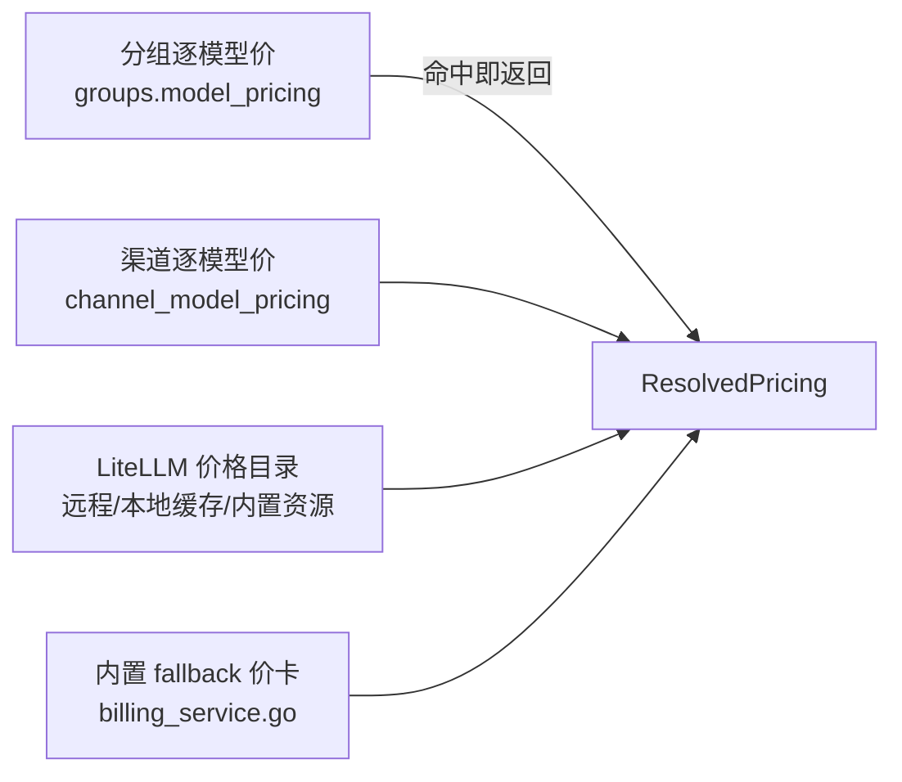

# 人民币计费改造分析

> 分析对象：`ranxi2001/sub2api` production 分支（HEAD `5929843ff`，VERSION `2.12.2`）
> 分析日期：2026-10-19
> 方法：静态代码阅读 + DeepSeek 官方定价页核对。本地 Go 工具链为 1.26.0，`backend/go.mod` 要求 1.27.2，工具链下载被网络阻断，**本次未执行 `go build` / `go test`**，所有结论基于源码与官方文档，未经运行验证。

---

## 1. 结论摘要

1. **系统当前是"人民币收款、美元记账"**。支付网关默认 CNY（`backend/internal/payment/currency.go:10`），但用户余额、用量成本、配额全部是无币种标记的 USD 数值，中间靠一个倍率配置把人民币充值折算成美元余额。
2. **模型价格已经可以自己配置，且有三层覆盖**：分组逐模型价 → 渠道逐模型价 → LiteLLM 目录 → 内置兜底价。缺的不是"可配置"，而是**币种**和**峰谷价档**。
3. **峰谷能力已经存在三套，但互斥**：DeepSeek 硬编码峰谷、渠道分时倍率、分组高峰倍率。三者生效条件互相排斥，且时区口径不统一。分组级定价被明确禁止配置分时（`backend/internal/service/admin_group.go:1175`）。
4. **DeepSeek 当前实现与官网口径有两处偏差**：缺少中国法定节假日判定；`deepseek-v4-pro` 被强制按 Flash 价计费，但官网当前仍单独列出 Pro 价。这两处会导致实际扣费与官网不一致（详见第 4 节）。
5. **直接改展示层不成立**。国产模型的人民币官网价与美元官网价不是同一汇率（DeepSeek Flash 隐含 6.67，Pro 隐含 6.82，而仓库里其他国产模型用的是 7.14）。要"官网价而不是简单换算"，必须让**每条价格自带币种**，记账币种改为人民币。

---

## 2. 现状盘点

### 2.1 记账币种：事实上的 USD

| 对象 | 字段 | 类型 | 语义 |
|---|---|---|---|
| 用户余额 | `users.balance` / `frozen_balance` / `total_recharged` | `decimal(20,8)` / float64 | USD |
| 用量成本 | `usage_logs.input_cost` / `output_cost` / `cache_*_cost` / `total_cost` / `actual_cost` | `decimal(20,10)` | USD |
| Key 配额 | `api_keys.quota` / `quota_used` / `rate_limit_*` / `usage_*` | `decimal(20,8)` | USD |
| 分组限额 | `groups.daily/weekly/monthly_limit_usd` | `decimal(20,8)` | USD |
| 订阅用量 | `user_subscriptions.*_usage_usd` | `decimal(20,10)` | USD |
| 平台配额 | `user_platform_quotas.*_limit_usd` / `*_usage_usd` | `decimal(20,10)` | USD |
| 兑换码 / 促销码 | `redeem_codes.value` / `promo_codes.bonus_amount` | `decimal(20,8)` | USD |

证据：`backend/ent/schema/user.go:50`、`backend/ent/schema/usage_log.go:93`、`backend/ent/schema/api_key.go:67`、`backend/ent/schema/group.go:90`、`backend/ent/schema/user_subscription.go:62`、`backend/ent/schema/user_platform_quota.go:54`。

**关键事实：除 `subscription_plans.currency`（仅展示）和 `batch_image_jobs.currency`（固定 `'USD'`）外，所有金额列都没有币种列。** `usage_logs` 全文没有 `currency` 字段。

### 2.2 支付币种：已经是 CNY

- `DefaultPaymentCurrency = "CNY"`（`backend/internal/payment/currency.go:10`）。
- 支付宝、微信、易支付硬编码人民币；Stripe / Airwallex 可配置币种。
- 订单两个金额口径（`backend/ent/schema/payment_order.go:46`）：
  - `amount` = 到账额度（USD 语义，含赠金）
  - `pay_amount` = 网关实收（渠道币种，含手续费）
- 人民币转美元靠 `BALANCE_RECHARGE_MULTIPLIER`（`backend/internal/service/payment_amounts.go:28`），本质是"1 元 = X 美元余额"。
- 订阅另有一个 `SUBSCRIPTION_USD_TO_CNY_RATE`（`backend/internal/service/payment_config_service.go:30`），只在订阅单且网关币种为 CNY 时生效。

也就是说，**"人民币收款"这件事已经做完了，缺的是把记账侧也换成人民币**。

### 2.3 价格来源：四级覆盖

解析顺序（`backend/internal/service/model_pricing_resolver.go:72`）：



- 分组价优先级最高，命中后不再看渠道（`model_pricing_resolver.go:74`）。
- 渠道价支持区间阶梯（`channel_pricing_intervals`）与分时（`time_pricing`）。
- 目录来源：远程 URL → 本地缓存 `<data_dir>/model_pricing.json` → 仓库内置 `backend/resources/model-pricing/model_prices_and_context_window.json`（208 个模型条目）。
- 找不到价格时：`ErrModelPricingUnavailable`，网关捕获后按 0 元记账并照常落 usage 日志（`backend/internal/service/gateway_usage_billing.go:1299`）。这是一个静默漏计费点。

**所有价格字段都是 USD / token**，`ModelPricing` 的每个字段注释都写着 `(USD)`（`backend/internal/service/billing_service.go:98`）。前端编辑单位是 `$/MTok`（`frontend/src/components/admin/channel/PricingEntryCard.vue:107`），per-token 与 per-MTok 的换算在 `frontend/src/components/admin/channel/types.ts:211`。

### 2.4 计费链路

```
usage tokens
  → ModelPricingResolver.Resolve（分组 → 渠道 → 目录 → fallback）
  → GetIntervalPricing（区间阶梯）
  → applyModelSpecificPricingPolicyEx（DeepSeek 强制官方价）
  → DeepSeek 峰谷倍率（仅 Source=LiteLLM）
  → computeTokenBreakdown（六项分项求和 = TotalCost）
  → × rateMultiplier（系统 → 分组 → 用户 → 账号 → 分组高峰）
  → × 渠道分时倍率（仅 Source=Channel）
  → × 推理等级倍率
  → × 模型加价倍率
  → ActualCost
  → UsageBillingCommand.Normalize()（量化到 8 位）
  → 原子扣减余额 / 订阅 / Key 配额 / 平台配额
```

核心函数：`computeTokenBreakdown`（`backend/internal/service/billing_service.go:1652`），`ActualCost = TotalCost × rateMultiplier` 在 `:1761`。

精度保护：扣费前统一量化到 8 位小数（`backend/internal/service/usage_billing.go:60`），原因注释写得很清楚——余额做减法、配额做加法，PostgreSQL 两侧舍入方向相反会产生 1e-8 累积差。

---

## 3. 你关心的三项能力，现状各到什么程度

### 3.1 "自己配置模型金额"：已经能做，但只能配美元

| 层级 | 载体 | 币种 | 管理端入口 |
|---|---|---|---|
| 分组逐模型 | `groups.model_pricing` JSONB | 无（USD） | `GroupsView.vue` 模型定价区 |
| 渠道逐模型 | `channel_model_pricing` 表，`NUMERIC(20,12)` | 无（USD） | `ChannelsView.vue` → `PricingEntryCard.vue` |
| 全局覆盖文件 | `pricing.override_file` | 无（USD） | 配置文件，无 UI |

结论：**"可配置"不缺，"按人民币官网价录入"缺**。目前要把 ¥4.5/MTok 录进去，得先自己除以 7.14 或 6.82，录进去的值和官网对不上。

### 3.2 峰谷：三套机制并存且互斥

| 机制 | 判定函数 | 生效条件 | 粒度 |
|---|---|---|---|
| DeepSeek 官方峰谷 | `deepseekPeakMultiplierAt`（`billing_service.go:302`） | 仅 `Source == LiteLLM` 且模型名 `deepseek-*` | 固定时段，2 倍 |
| 渠道分时倍率 | `ChannelTimePricing.MultiplierAt`（`custom_channel_time_pricing.go:33`） | 仅 `Source == Channel` | 任意时区、多时段、可仅工作日 |
| 分组高峰倍率 | `Group.PeakMultiplierAt`（`group.go:323`） | 仅订阅类型分组 | 单区间、不支持跨天 |

三个问题：

1. **分组定价被禁止分时**：`admin_group.go:1175` 直接返回 `GROUP_MODEL_TIME_PRICING_UNSUPPORTED`。而分组价优先级最高，一旦运营者给某个模型配了分组价，渠道分时和 DeepSeek 峰谷**全部失效**。这正好卡住"我要自己配价 + 要峰谷"的组合。
2. **时区口径三套**：DeepSeek 用硬编码 `+8`，分组用全局 `timezone.Location()`，渠道用配置自带时区。
3. **零值时点导致渠道分时静默失效**：`calculateTokenCost` 把 `input.PricingAt` 原值传给渠道分时（`billing_service.go:1645`），而 `MultiplierAt` 遇到零值直接返回 1.0（`custom_channel_time_pricing.go:34`）；同一函数里 DeepSeek 峰谷却已经做了零值回退（`:1618`）。这是不对称行为。

### 3.3 官网价：完全没有

所有国产模型的价格都是"人民币官网价 ÷ 7.14"再录入，注释里明写：`billing_service.go:934`「汇率口径 ÷7.14（与本表其他国产模型一致，¥1≈$0.14）」。

这带来两个后果：
- 录入值与官网值不可对账；
- 不同模型的隐含汇率不一致（DeepSeek 官方美元价隐含 6.67/6.82），统一用 7.14 会系统性低估国产模型成本。

---

## 4. DeepSeek 口径核对（与官网比对后的两个缺陷）

官方定价页（`https://api-docs.deepseek.com/zh-cn/quick_start/pricing`，2026-10-19 读取）：

| 模型 | 输入（缓存命中） | 输入（缓存未命中） | 输出 |
|---|---|---|---|
| deepseek-flash 空闲 | ¥0.02 | ¥1 | ¥4 |
| deepseek-flash 高峰 | ¥0.04 | ¥2 | ¥8 |
| deepseek-v4-pro 空闲 | ¥0.15 | ¥4.5 | ¥13.5 |
| deepseek-v4-pro 高峰 | ¥0.30 | ¥9.0 | ¥27.0 |

官方口径：**北京时间周一至周五（不含中国法定节假日）9:00–12:00、14:00–18:00 为高峰**，其余时段（含周末与中国法定节假日全天）为空闲。空闲价是高峰价的一半。

### 缺陷 1：缺节假日判定

`deepseekPeakMultiplierAt`（`billing_service.go:302`）只判断周六周日，**没有任何中国法定节假日日历**（全仓 `holiday` / `法定节假日` 零命中）。后果：国庆、春节等工作日会被按 2 倍高峰价计费，与官网不一致。

### 缺陷 2：`deepseek-v4-pro` 被强制按 Flash 价

`deepseekProRoutesToFlashAt = 2026-09-14 04:00 UTC`（`billing_service.go:318`），到点后 `deepseekProBilledAsFlash` 返回 true，Pro 请求按 Flash 三档价计费（`billing_service.go:1922`）。

但当前官网仍**单独列出 `deepseek-v4-pro` 的价格**，且脚注只说明旧名 `deepseek-v4-flash` / `deepseek-v4-flash-vision-exp` 已下线、由 V4.1-Flash 提供服务。没有"Pro 请求按 Flash 计费"的说明。

按 Flash 价计 Pro，大约是应收费用的 1/4.5。这是**当前正在发生的少收费**，需要你确认是否曾经有过临时公告、以及现在是否应回退到 Pro 价。

### 其他口径问题

- `isDeepSeekProModel` 用 `strings.Contains(model, "deepseek-v4-pro")`（`:332`），未来出现 `deepseek-v4-pro-lite` 之类会误判为 Pro 档。
- 任何未知的 `deepseek-*` 一律按 Flash 价兜底（`:1129`），新模型上线到价卡更新之间会被低估。
- `applyModelSpecificPricingPolicyEx` 对 DeepSeek **无条件强制官方价**（`:1920`），意味着运营者在分组/渠道里配的 DeepSeek 价格会被直接覆盖回官方价——"自己配价"对 DeepSeek 实际不生效。

---

## 5. 三个可选方案

### 方案 A：只改展示，内部继续 USD

- 成本：最低。只动前端格式化 + 一个汇率配置。
- 问题：国产模型官网价仍要先换算成美元录入，永远对不上官网；用户看到的"人民币价格"是二次换算结果。**不满足"官网价而不是简单换算"**。

### 方案 B：内部统一改 CNY，海外模型按汇率折算

- 成本：中高。需要迁移全部历史金额、重建预聚合、重标定全部 fallback 价卡、改大量测试。
- 收益：记账、展示、支付三侧统一，用户侧零折算。
- 问题：海外模型（OpenAI / Claude / Gemini）只有美元官网价，必须依赖汇率；汇率一变，历史成本口径就漂移。

### 方案 C（推荐）：CNY 记账 + 价格条目自带币种 + 统一时段定价引擎

- 记账币种 = CNY。
- **每条价格带 `currency`**：国产模型直接录人民币官网价（`CNY`），海外模型保留美元官网价（`USD`），计费时按**带生效时间的汇率快照**折成 CNY。
- 峰谷升级为"时段价档"，支持绝对价而不只是倍率，并内置中国法定节假日日历。
- 历史数据：金额列加币种/汇率快照，历史行标记为 USD 保留原值，聚合时折算；余额/配额这类累计值一次性换算。

这个方案同时满足三个诉求：官网价直录、金额可配、峰谷可配，且不牺牲海外模型的官方价准确性。

---

## 6. 推荐方案详细设计

### 6.1 数据模型

**价格条目增加币种**（`ModelPricing`，`billing_service.go:98`）：

```go
type ModelPricing struct {
    // ... 现有 per-token 字段保持不变 ...
    // Currency 是该价格条目的币种（ISO 4217）。空值表示记账币种。
    // "USD" 表示价格以美元官网价录入，计费时按汇率快照折算。
    Currency string
}
```

`ChannelModelPricing`（`backend/internal/service/channel.go:90`）同步增加 `Currency`，落到 `channel_model_pricing.currency`；`groups.model_pricing` JSONB 内增加 `currency` 字段（JSONB 无需迁移列）。

**时段定价结构**（扩展现有 `ChannelTimePricing`，`channel.go:113`）：

```go
type TimePricingPeriod struct {
    StartTime  string
    EndTime    string
    Multiplier float64 // 现有语义
    // 绝对价（每 token，与 ModelPricing 同单位）。
    // 任一非 nil 时优先于 Multiplier，用于表达"峰/谷不同价"而非"峰时加价"。
    InputPrice      *float64
    OutputPrice     *float64
    CacheReadPrice  *float64
    CacheWritePrice *float64
}

type TimePricing struct {
    Timezone     string
    WeekdaysOnly bool
    Holidays     []string // YYYY-MM-DD；命中当日不套用任何 period（= 空闲价）
    Periods      []TimePricingPeriod
}
```

**汇率快照**：

```go
type FXRate struct {
    Base     string    // "USD"
    Quote    string    // "CNY"
    Rate     float64   // 1 USD = Rate CNY
    EffectiveAt time.Time
}
```

存 `settings` 表即可（`backend/ent/schema/setting.go`），参照 `SUBSCRIPTION_USD_TO_CNY_RATE` 的解析方式。计费时按 `PricingAt` 取当时生效的汇率，写入 usage 日志快照。

### 6.2 计费链路改造

在 `calculateTokenCost`（`billing_service.go:1596`）中插入三步，顺序很重要：

```go
// 1. 解析价格条目（分组/渠道/目录/fallback 不变）
pricing := input.Resolver.GetIntervalPricing(resolved, pricingContext)

// 2. 币种折算：把价格条目折成记账币种（CNY）
//    必须在倍率之前，倍率才与币种无关
pricing = s.convertPricingCurrency(pricing, accountingCurrency, fxRateAt(pricingAt))

// 3. 时段价档：绝对价优先，否则用倍率
pricing = applyTimeTier(pricing, resolved.TimePricing, pricingAt)

// 4. 原有逻辑：分项求和 → 倍率 → ActualCost
```

同时修正两个现有问题：

- 把 `resolvedChannelTimeMultiplier(resolved, input.PricingAt)`（`:1645`）改为使用已回退的 `pricingAt`，消除零值时点导致的静默失效。
- 时段价档不再限制 `Source`。时段表属于价格条目自身属性，分组价、渠道价、目录价各自带自己的时段表；解析到哪条就用哪条。

### 6.3 峰谷/节假日

- 内置一份中国法定节假日表（代码常量或 JSON 资源），支持配置覆盖；每年更新一次。
- DeepSeek 的硬编码峰谷改为**内置默认时段表**，挂在 fallback 价卡上：

```go
// 北京时间周一至周五 09:00-12:00、14:00-18:00 为高峰（不含法定节假日）
TimePricing: &TimePricing{
    Timezone:     "Asia/Shanghai",
    WeekdaysOnly: true,
    Holidays:     chinaPublicHolidays,
    Periods: []TimePricingPeriod{
        {StartTime: "09:00", EndTime: "12:00", Multiplier: 2.0},
        {StartTime: "14:00", EndTime: "18:00", Multiplier: 2.0},
    },
},
```

这样运营者在管理端就能看到、能改、能关，而不是埋在 Go 常量里。同时要**取消对 DeepSeek 的强制官方价覆盖**（`billing_service.go:1920`），否则自定义价格永远被盖回去。

### 6.4 管理端

现有入口都在，只需要扩展字段：

| 位置 | 改动 |
|---|---|
| `backend/internal/handler/admin/channel_handler.go:597` | 默认定价返回体带 `currency` |
| `backend/internal/service/admin_group.go:1169` | 删除对分时定价的拒绝，改为透传 |
| `backend/internal/service/channel_service.go:682` | 校验新增：币种合法、时段绝对价与倍率互斥、节假日格式 |
| `backend/internal/server/routes/admin.go:966` | 新增汇率配置读写（可并入系统设置） |

前端：

| 位置 | 改动 |
|---|---|
| `frontend/src/components/admin/channel/PricingEntryCard.vue:107` | `$/MTok` → 动态币种单位 |
| `frontend/src/components/admin/channel/TimePricingSection.vue` | 增加"绝对价"编辑模式与节假日列表 |
| `frontend/src/views/admin/GroupsView.vue:1538` | 分组模型定价开放分时配置 |
| `frontend/src/components/admin/channel/types.ts:211` | per-token ↔ per-MTok 换算需带上币种 |

### 6.5 前端金额展示收口

当前状态：`frontend/src/utils/pricing.ts:23` 与 `frontend/src/utils/usagePricing.ts:48` 在函数体里写死 `$`；`frontend/src/utils/format.ts:61` 的 `formatCurrency` 默认 `USD` 且空值返回 `'$0.00'`；全仓约 **179 处**硬编码 `$`（55 个文件）。支付域倒是已经有可用的 `currencySymbol()` / `formatPaymentAmount()`（`frontend/src/components/payment/currency.ts`），但被埋在 payment 目录下，成本域用不到。

建议：

1. 把 `currency.ts` 提升为全局 `utils/money.ts`，提供 `formatMoney(amount, {currency, digits})`。
2. 记账币种从 `PublicSettings` 下发（`frontend/src/types/index.ts:212` 新增 `billing_currency`），前端不再假设 USD。
3. `formatScaled` / `formatTokenPricePerMillion` 增加币种参数，逐个替换调用点。
4. i18n 里写死的 `'$ / 1M tokens'`（`zh/dashboard.ts:814`、`en/dashboard.ts:810`）改为无符号或占位符。

### 6.6 迁移

迁移机制（`backend/migrations/README.md`）：文件名 `NNN_description.sql`，当前最大 `290`；**只进不退，无 down 迁移**；启动时自动执行；带 checksum，改历史文件会拒绝启动。

建议新增两个迁移：

**`291_billing_currency.sql`**

```sql
-- 记账币种迁移记录（幂等守卫 + 汇率快照）
CREATE TABLE IF NOT EXISTS billing_currency_migrations (
    version       text PRIMARY KEY,
    from_currency text NOT NULL,
    to_currency   text NOT NULL,
    fx_rate       numeric(20,10) NOT NULL,
    applied_at    timestamptz NOT NULL DEFAULT now()
);

-- 价格条目币种
ALTER TABLE channel_model_pricing ADD COLUMN IF NOT EXISTS currency varchar(3) NOT NULL DEFAULT '';
ALTER TABLE groups ADD COLUMN IF NOT EXISTS model_pricing_currency varchar(3) NOT NULL DEFAULT '';

-- usage_logs 币种与折算快照
ALTER TABLE usage_logs ADD COLUMN IF NOT EXISTS currency varchar(3) NOT NULL DEFAULT 'USD';
ALTER TABLE usage_logs ADD COLUMN IF NOT EXISTS fx_rate numeric(20,10) NOT NULL DEFAULT 1;
```

**`292_convert_balance_to_cny.sql`**

只换算"累计值"（小表、可一次性更新），并写幂等守卫：

- `users.balance` / `frozen_balance` / `total_recharged` / `balance_notify_threshold`
- `api_keys.quota` / `quota_used` / `rate_limit_*` / `usage_*`
- `groups.*_limit_usd` / 图片视频搜索语音价
- `user_subscriptions.*_usage_usd`、`user_platform_quotas.*`
- `redeem_codes.value`、`promo_codes.bonus_amount`

**不换算**：`payment_orders.amount` / `pay_amount` / `refund_amount`——它们对应真实收付，与网关对账绑定，换算会直接破坏金额校验。

**`usage_logs` 处理**：历史行保留原值，标记 `currency='USD'`，`fx_rate` 填迁移时的统一汇率；新行 `currency='CNY'`、`fx_rate=1`。聚合查询改为 `SUM(actual_cost * fx_rate)`，这样报表口径统一，原始记录无损。

**预聚合表必须清空重建**：`usage_dashboard_hourly` / `usage_dashboard_daily` / `usage_group_daily_rollups` 存的是物化金额，不清空会新旧单位混算。重建入口在 `backend/internal/service/dashboard_aggregation_service.go:158`。

---

## 7. 风险清单

| 风险 | 影响 | 说明 |
|---|---|---|
| 支付侧双重折算 | 高 | `BALANCE_RECHARGE_MULTIPLIER` 与 `SUBSCRIPTION_USD_TO_CNY_RATE` 在人民币记账后会再乘一次，必须一次性清零并迁移存量配置 |
| 历史订单被追溯改标 | 高 | `payment_orders` 没有 `currency` 列，币种只在 `provider_snapshot`；改默认币种会让老订单回读成新币种 |
| 倍率精度不足 | 中 | `usage_logs.rate_multiplier` 是 `decimal(10,4)`，但 `ActualCost` 用的是 float64 全精度连乘，无法由日志反推 |
| 聚合查询隐含单位 | 中 | 所有 `SUM(actual_cost)` 直接与限额列比较，改单位必须同步 |
| Ent 与真实表漂移 | 中 | `image_input_cost` / `image_output_cost` / `account_stats_cost` 三列不在 ent schema，只在手写 SQL 里写入 |
| 非 OpenAI 网关丢图片输入费 | 中 | `gateway_usage_billing.go` 未回填 `ImageInputCost`（OpenAI 路径有，见 `openai_gateway_usage.go:444`），导致分项之和不等于 `total_cost`，破坏对账基数 |
| 前端 179 处硬编码 `$` | 中 | 分散在 55 个文件，需分批替换 |
| 测试大量断言具体金额 | 中 | 后端约 30 个测试文件断言金额；前端 `UsageTable.spec.ts` 在 `Makefile` 必绿集合里 |
| 分组价覆盖导致峰谷失效 | 高 | 现状下给模型配分组价即失去峰谷，必须在同一期修复 |
| 迁移不可回滚 | 中 | 无 down 迁移，checksum 校验会拒绝启动；换算迁移必须自带幂等守卫 |

---

## 8. 分阶段落地建议

**第一阶段：修正确性缺陷（与币种无关，可独立上线）**

1. 补中国法定节假日日历，修正 DeepSeek 高峰判定。
2. 核对 `deepseek-v4-pro` 是否仍应按 Flash 价计费；若否，移除 `deepseekProBilledAsFlash` 分支。
3. 取消对 DeepSeek 的强制官方价覆盖，让自定义价格真正生效。
4. 修正渠道分时的零值时点失效。
5. 补齐 `ImageInputCost` 回填。

**第二阶段：数据模型与汇率**

6. 新增币种/汇率/时段价档字段与迁移。
7. 实现 `convertPricingCurrency` 与 `applyTimeTier`，替换 DeepSeek 硬编码峰谷。
8. 管理端与前端定价表单支持币种与峰谷档。

**第三阶段：历史数据与展示**

9. 换算累计金额列，重建预聚合。
10. `usage_logs` 加币种标记，聚合查询改折算口径。
11. 前端统一 `formatMoney`，清除硬编码 `$`。
12. 支付侧下线双重折算配置。

---

## 9. 需要你决策的三件事

1. **历史用量数据怎么处理**：标记保留（无损、报表需折算）还是统一换算（简单、不可逆）？
2. **汇率谁来定**：固定配置项、每日人工维护，还是接一个汇率源自动更新？
3. **DeepSeek Pro 当前应按什么价计费**：官网现在单独列 Pro 价，但代码按 Flash 计费，需要确认业务口径。

---

## 10. 未验证项

- 未运行 `go build` / `go test` / 前端构建（Go 版本不匹配且工具链下载被阻断）。
- 生产库中 `BALANCE_RECHARGE_MULTIPLIER` 与 `SUBSCRIPTION_USD_TO_CNY_RATE` 的实际取值未知，影响风险 1 的严重度。
- 历史 `usage_logs` 数据量未知，影响换算迁移的执行方式（在线 UPDATE 还是分批）。
- `groups.model_pricing` JSON 内价格的单位（USD/token）由解析器用法推断，未找到显式单位注释。
